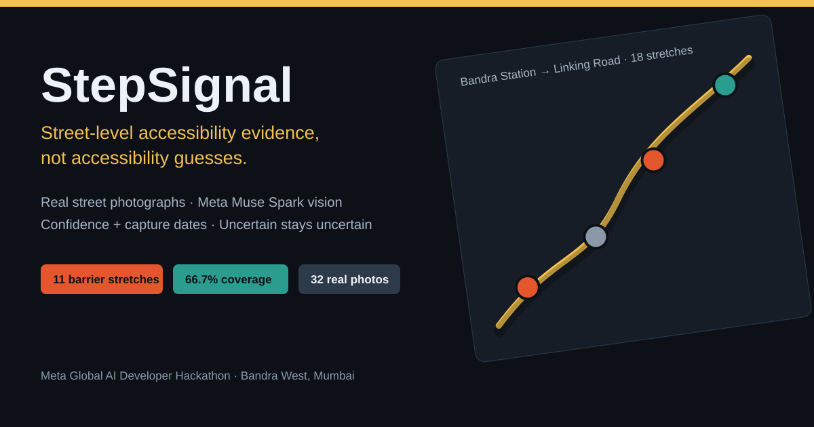

# StepSignal



**Street-level accessibility evidence for wheelchair users and people with mobility impairments.**

Front page (about, how to use, FAQ, help desk, add-a-photo): http://localhost:3001 · Live evidence map: http://localhost:3001/map

Screenshots / demo video: no hosted video yet — use the cover page and the [2-minute demo script](docs/DEMO.md) to record one. No screenshot or video link is claimed here because none has been published.

StepSignal samples a walking route every ~50 metres, retrieves real street-level photographs (Mapillary), analyses each one with Meta **Muse Spark (`muse-spark-1.3`)**, and shows — for every stretch — what obstacles were actually detected, where they are, which photograph supports each observation, how confident the model was, and how old the evidence is.

It deliberately does **not** work like a conventional accessibility map. A route is never declared "wheelchair accessible" from photographs. Each stretch is exactly one of:

- **Confirmed barrier** — barrier evidence in a photograph or map feature at confidence ≥ 0.6
- **No barrier visible in the available evidence** — analysed evidence exists and no barrier was seen in it
- **Uncertain** — insufficient evidence. Missing data is never upgraded to accessible.

Demo neighbourhood: **Bandra West, Mumbai** (Bandra Station → Linking Road Bandra, 1.2 km, 18 stretches, 66.7% evidence coverage, 11 stretches with confirmed barriers).


## Quick start (verified demo, no API keys needed)

```bash
cd backend && python3 -m venv .venv && .venv/bin/pip install -r requirements.txt
.venv/bin/uvicorn app.main:app --port 8001

cd ../frontend && npm install && npm run dev
```

Open http://localhost:3001 for the front page, then choose **Open live map** (or go directly to http://localhost:3001/map). The verified Bandra evidence report loads automatically — click the coloured pins, filter stretches, enlarge photographs. All 32 analysed photographs are cached in `docs/evidence-report.json`, so the demo makes no paid model calls. Community photo/location submissions from the front page are stored via `POST /api/contributions` for review; they are never shown as verified evidence on arrival.

## Fresh route analysis

Copy `.env.example` to `.env` and set:

| Variable | What |
|---|---|
| `MAPILLARY_ACCESS_TOKEN` | Free token from mapillary.com → Developers |
| `MODEL_API_KEY` | Meta Model API key (Bearer, https://api.meta.ai/v1) |
| `VISION_MODEL` | `muse-spark-1.3` (default) |
| `SAM_API_URL` | Optional SAM 3.1 endpoint; masks are shown only if this returns one |

Then use **Analyse a new route** in the UI, or `POST /api/brief` with `{"origin": "...", "destination": "..."}`. Costs: one Muse Spark call per uncached photograph, cached in SQLite thereafter. Nothing is mocked: without keys, stretches report as uncertain with explicit warnings.

Batch-analyse and cache a whole route (parallel, resumable):

```bash
cd backend && .venv/bin/python scripts/run_full_route.py "Bandra Station" "Linking Road Bandra"
```

## Architecture

```
Next.js + MapLibre GL (3D-tilted map, evidence drawer, lightbox)
        │  GET /api/report (cached) · POST /api/brief (fresh)
FastAPI ─┬─ OSRM walking route + alternate
         ├─ 50 m sampling (haversine)
         ├─ Mapillary Graph API (deduped photos, capture dates)
         ├─ OpenStreetMap/Overpass (kerb, tactile paving, surface, wheelchair tags)
         ├─ Muse Spark vision → structured JSON (confidence + evidence, null = uncertain)
         ├─ SAM 3.1 hook (optional segmentation masks)
         └─ Continuity engine: per-stretch classification + route coverage %
```

Key engineering details: images are embedded as base64 (the Meta Model API cannot fetch Mapillary thumbnail URLs); Mapillary `captured_at` epoch-ms is normalised to ISO dates; a curl fallback works around old LibreSSL TLS failures; every model observation is validated against a Pydantic schema before it touches the UI.

## Tests & CI

```bash
cd backend && .venv/bin/python -m pytest tests -q   # 30 tests
cd frontend && npm run build
```

GitHub Actions (`.github/workflows/ci.yml`) runs both on push/PR.

## Integrity rules (enforced in code, tested)

- Missing evidence ⇒ uncertain. Never accessible, never a barrier.
- `present: null` is preserved end to end; an unobserved feature is not "absent".
- Gradients, widths, and surface quality are never measured from photographs.
- People in photographs are never identified or characterised.
- No fabricated photographs, masks, map features, or model responses — anywhere.

## Docs

- [Submission & judges guide](docs/SUBMISSION.md)
- [2-minute demo script](docs/DEMO.md)
- [Verified evidence report (JSON)](docs/evidence-report.json)

## What is new vs reused

Built new for this pivot: accessibility schemas and vision prompt, continuity engine, Mumbai routing presets, SAM hook, evidence report pipeline, and this UI. Reused from SafeRoute Brief (built earlier in the same hackathon): 50 m sampling, the TLS-fallback HTTP helper, the Mapillary fetcher shape, and Next.js/FastAPI scaffolding patterns. SafeRoute Brief lives separately and is untouched.

## Licence

MIT — see `LICENSE`.
